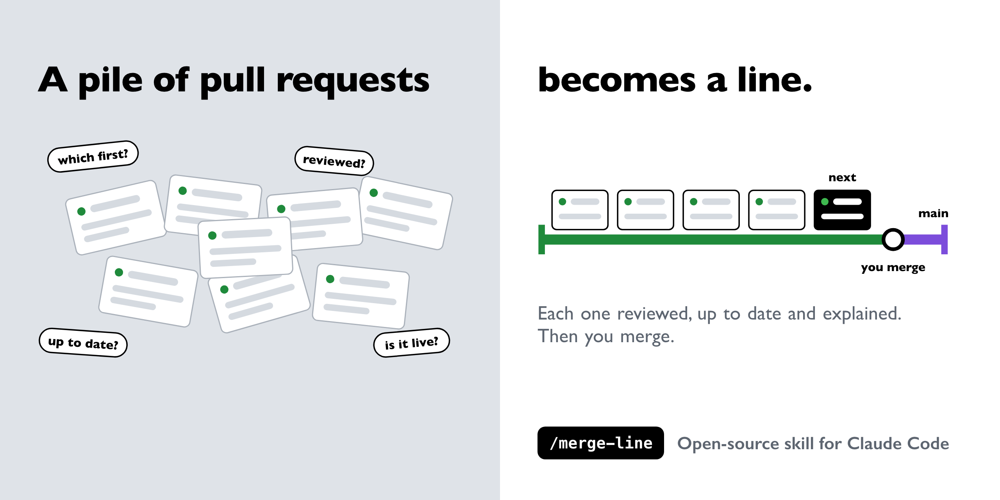
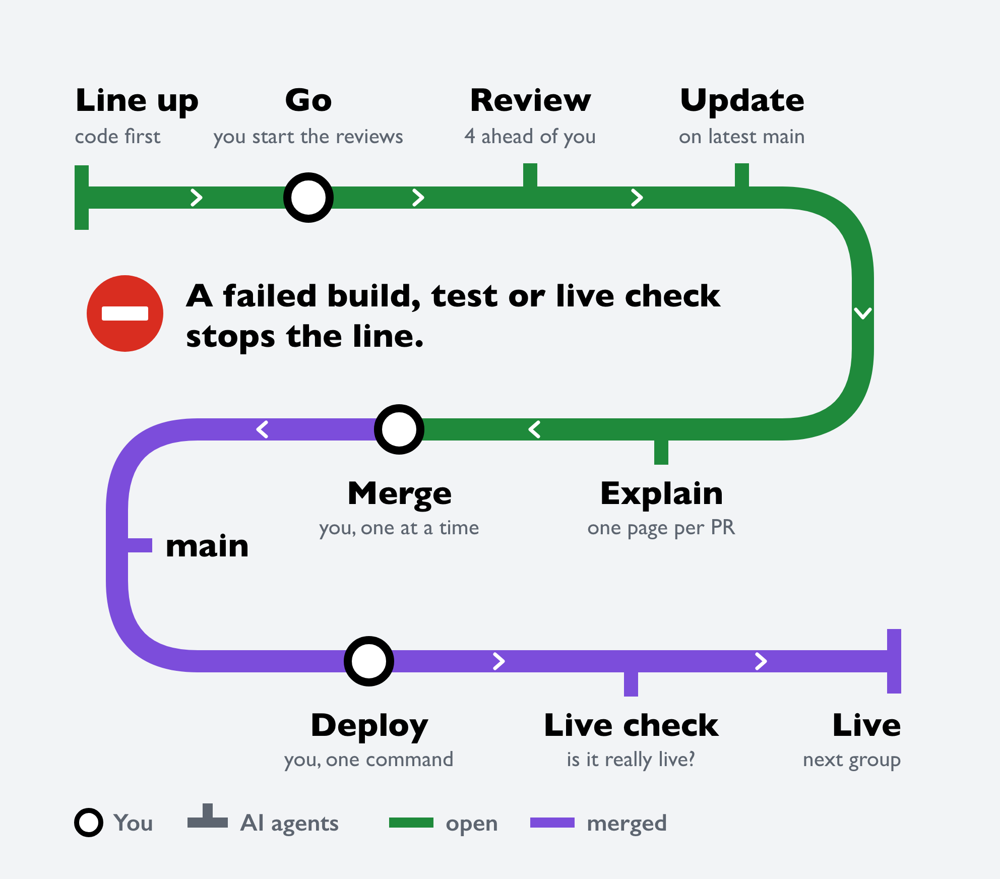
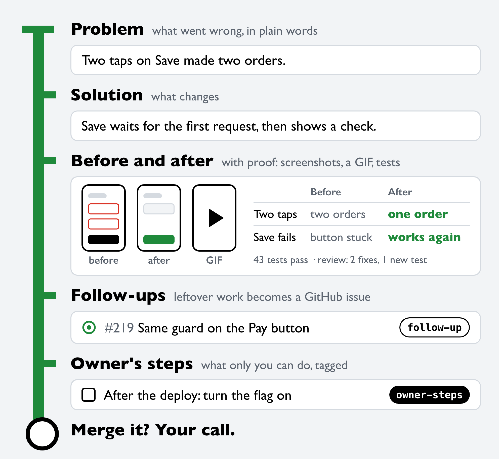
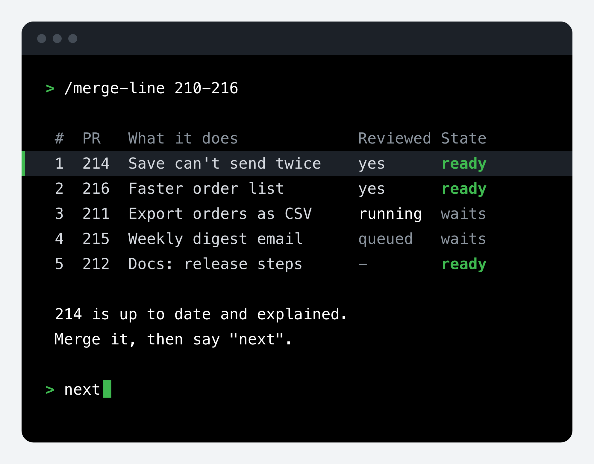

<p align="center">
  
</p>

<h1 align="center">/merge-line</h1>

<p align="center">
  <b>Merge a pile of pull requests, one at a time.</b><br>
  AI does the reading. You make three calls: <b>go</b>, <b>merge</b>, <b>deploy</b>.
</p>

<p align="center">
  A skill for <a href="https://code.claude.com">Claude Code</a> · MIT licence
</p>

---

## In 10 seconds

| | |
|---|---|
| **What** | You give it PR numbers. It puts them in order, reviews them ahead, brings each one up to date, explains it on one page and asks you: *merge it?* |
| **Why** | No more reading diffs, juggling tabs or merging stale PRs. You read one page per PR, decide, and move on. |
| **Safe** | It never merges, deploys or force-pushes on its own. If anything breaks, the whole line stops. |

```
/merge-line 12 15 20-25
```

## Who does what

<p align="center">
  
</p>

| You | The AI crew |
|---|---|
| **Go**: start the reviews | `pr-state` reads each PR's state and checks |
| **Merge**: one PR at a time | `pr-reviewer` reviews 4 PRs ahead and fixes what it is sure of |
| **Deploy**: one command per group | `pr-updater` brings each PR up to date with `main` and reruns its tests |
| | `pr-explainer` writes one page per PR |
| | `live-check` checks the change is really live |

## Why it helps

- **One page, not a diff.** Every PR gets the same page: problem, solution, before and after (with the PR's screenshots or GIF), tests, risk, and what to check once it's live.
- **Reviews are done before you get there.** They run 4 PRs ahead, so you never wait for one.
- **Nothing is stale when you merge it.** Each PR is merged with the latest `main` and retested right before you decide.
- **A break stops the line.** A failed build, test or live check pauses everything until it's fixed.
- **Nothing gets forgotten.** Steps only you can do become checkboxes labelled `owner-steps`. Work for later becomes `follow-up` issues. Both live on GitHub, not in a chat.
- **One deploy per group.** PRs that ship together merge together, then deploy with one command.
- **Your session stays light.** Helpers do the reading, so one session lasts a whole run.

## What you read before each merge

<p align="center">
  
</p>

<details>
<summary>The same page, as the skill writes it</summary>

```markdown
**PR 214 · app · ready to merge**

1. A customer taps Save on a slow network.
2. The button turns into a spinner and ignores more taps.
3. The order is saved once; a check shows "Saved".

On a slow network, a second tap on Save sent a second request, and the
customer got two identical orders. Now the button waits for the first request.

| | |
|---|---|
| **Review** | 2 fixes + 1 test (the spinner never cleared after an error) |
| **Tests** | 43 passed |
| **Merge** | mergeable · up to date with main · no migration |
| **Deploy** | app: one deploy command, with PR 216 |
| **Owner steps** | none |
| **Risk** | low: only the Save button · undo: revert and deploy |
| **Decisions** | 1, "leave as is" |

| Case | Before | After |
|---|---|---|
| Two taps on Save, slow network | two orders (before) | one order, "Saved" (after · GIF) |
| Save fails | error, button stays enabled | error, button enabled again |

**Follow-ups:** #219 Same guard on the Pay button
**Once it's live:** no duplicate orders in the next day's report.
```

</details>

## Install

**As a plugin** (one command, easy updates):

```
/plugin marketplace add ahmadhori/merge-line
/plugin install merge-line@merge-line
```

Then run it as `/merge-line:merge-line 12 15`.

**By hand** (gives the short `/merge-line`):

```bash
git clone https://github.com/ahmadhori/merge-line
mkdir -p ~/.claude/skills ~/.claude/agents
cp -r merge-line/skills/merge-line ~/.claude/skills/
cp merge-line/agents/*.md ~/.claude/agents/
```

**You need:** Claude Code, git, the [GitHub CLI](https://cli.github.com) signed in (`gh auth login`), and a repository on GitHub.

## Use

| Command | What it does |
|---|---|
| `/merge-line 12 15 20-25` | Takes these PRs (a range means every open PR in it) and shows the merge order |
| `/merge-line` | Lists the open PRs and asks which |
| `/merge-line postpone 18 waits on the release` | Sets PR 18 aside (label `postponed`) until you resume it |
| `/merge-line planning 30` | Sets PR 30 aside as a plan still being worked out |
| `/merge-line resume 18` | Takes PR 18 back into ranges |

Then just answer it: **go**, **next**, **merged**, **done**.

## A run, step by step

<p align="center">
  
</p>

The picture shortens the table. The real one also shows each PR's type, area, deploy and the steps only you can do.

1. **The table.** Your PRs in merge order: code first, grouped by deploy. Each row shows whether it's reviewed, what its deploy takes and any steps only you can do.
2. **Go.** Reviews start for the first 4 code PRs and keep 4 ahead of you.
3. **Next.** The PR at the front is brought up to date and explained on one page.
4. **Merge.** You merge it (on GitHub, or tell Claude to merge that one), then say *next*.
5. **Deploy.** When the last PR of a group is in, you get its deploy as one command, with your steps before and after it.
6. **Live check.** A helper checks the change is really live. If it isn't, the line stops.

## Configure (optional)

It works without setup. To teach it your project, copy [`templates/merge-line.md`](templates/merge-line.md) to `.claude/merge-line.md` in your repository:

| Section | Tells it | Default |
|---|---|---|
| Branch | where PRs merge | your default branch |
| Tests | how to test a few files, and everything | your project's test command |
| Generated files | what to regenerate after a merge, never hand-merge | lockfiles |
| Version | a bump each PR runs before it's pushed | none |
| Deploy groups | which paths deploy together, the command, the live check | none: a merge is the end of the line |
| Migrations | which files make a PR "migration first" | none |
| Review | how many PRs to review ahead | 4 |

## Safety

- **It never merges or deploys on its own.** You do, or you tell it to for that one PR.
- **It never force-pushes or rebases.** Helpers merge `main` into the PR and push normally.
- **Helpers work in their own git worktrees** and remove them when they're done. Your checkout is never touched.
- **It never prints a secret** or puts one on a command line.

## FAQ

**Does it work without deploys?** Yes. Without deploy groups, a merge is the end of the line.

**How many PRs can I give it?** As many as you like. Only 4 are reviewed at a time, so stopping halfway wastes nothing.

**Does it need a particular language or framework?** No. It talks to git and GitHub, and runs your project's own tests.

**GitLab or Bitbucket?** Not yet: it uses the GitHub CLI.

**Where did it come from?** It's the workflow its author uses to merge AI-written PRs on a production app, made generic.

## License

[MIT](LICENSE)
